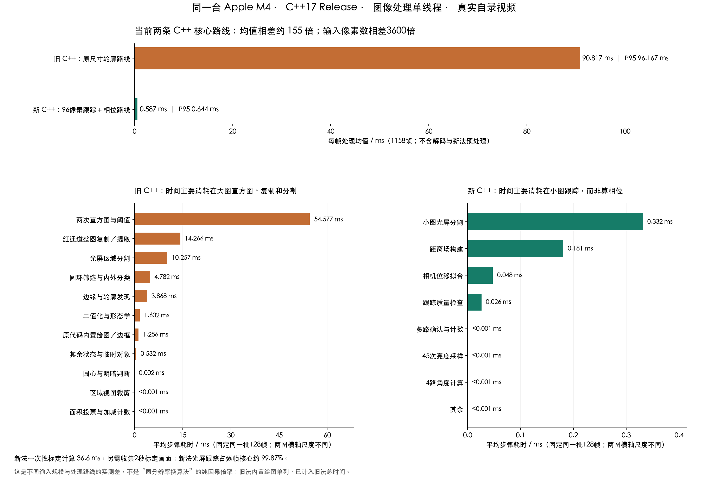
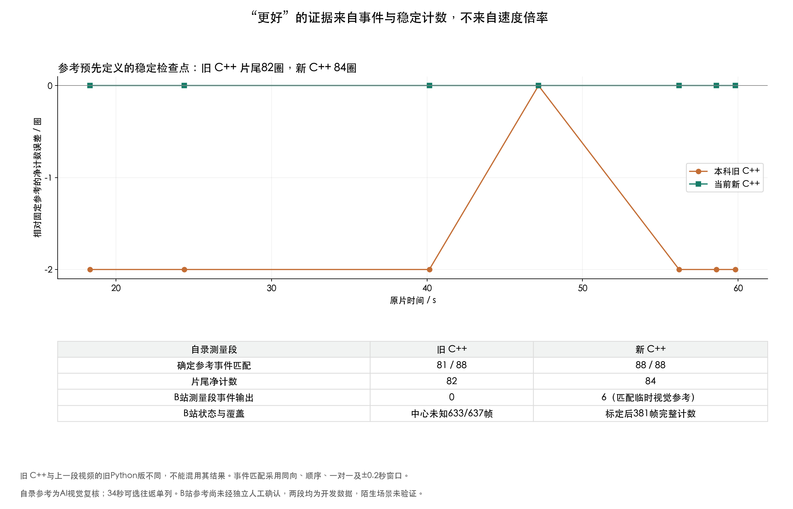

# 本科 C++ 与当前 C++：真实视频分步骤计时

2026-10-14，同一台 Apple M4，C++17 Release，图像算法单线程。本次没有修改正式计数核心。

本科确实有 C++ 实现。本次取 Git 历史 `c3ae479a0999f263b9365f1f94845e691e55d953:轮廓检测.cpp`，不是上一段左右对比视频使用的本科 Python 实现。两份本科实现的分割、掩膜和状态处理存在差异，不能混用计数结果。



## 速度：减少逐帧需要解决的问题

自录视频完整测量段，源帧279–1436，共1158帧：

| 当前处理路线 | 平均 / ms | 中位数 / ms | P95 / ms | P99 / ms |
|---|---:|---:|---:|---:|
| 本科 C++，原尺寸轮廓处理 | 90.817 | 90.351 | 96.167 | 107.686 |
| 当前 C++，96×96跟踪＋采样＋相位计数 | 0.587 | 0.581 | 0.644 | 0.694 |

当前两条路线的核心均值相差约155倍。旧法输入4320×7680 BGR，新法核心输入96×96红通道小图，输入像素数相差3600倍。这是当前实际处理策略的差异，**不是同分辨率替换算法的纯因果加速倍数，也不是 C++ 相对 Python 的倍数**。没有通过另行缩小旧法输入来检验旧法能否兼顾速度与准确度。

分步骤比较固定、均匀选取的同一批128帧；均为互斥计时，不重复累计嵌套步骤：

- 旧法两次直方图与阈值平均54.577ms，约60%；整图红通道复制/提取14.266ms，光屏分割10.257ms。面积投票和整数加减本身很便宜。原实现内置绘图/边框1.256ms，约1.4%，已单列且保留在旧法总耗时中。
- 新法几乎全部时间用于小图光屏分割、距离场、位移拟合和跟踪检查。仍然需要扫描96×96图像，并非整帧仅处理45个像素。跟踪后，五个3×3采样块提供45次双线性亮度采样，四路角度与确认计数分别低于0.001ms；这些微小分项受计时探针影响，不解读到纳秒精度。
- 空间结构、中心和信号选择主要放在一次性标定。标定计算36.602ms，其中参考/标定跟踪27.471ms、中心拟合8.516ms；另需采集固定2秒标定画面，二者不能混为初始化计算耗时。

数学上的简化是：旧法每帧重建轮廓及圆环状态，再间接判断变化；新法先建立光屏坐标和各路信号的相位关系，逐帧跟踪坐标、读取少量信号并估计共同相位推进。收益来自任务与数据规模的改变，不是反正切函数特别快。

## 准确度：独立于速度报告



自录固定物理参考为 `reference-v4.json`：88个确定事件，净84圈；34秒局部歧义按用户接受的可选减一/加一政策单列。参考主要由AI视觉复核建立，不能声称整段已获独立人工真值确认。

- 本科 C++：测量开始前累计8，片尾累计90，测量段相对净值82。当前 C++：净84，88个确定事件全部按固定规则匹配。
- 旧 C++ 按同方向、顺序、一对一、最多±0.2秒且相邻事件中点截断的协议，匹配81/88。其自身明暗阈值边界不同于参考的暗纹到达中心边界，不能把窗口不匹配直接说成整圈漏计。`quality.json`保留全部事件、未匹配项及协议。
- 为避免边界时间差解释全部误差，按参考中所有相邻事件间隔≥0.8秒的中点选检查点，排除可选歧义区间，再加片尾。七个检查点新法全部误差0，旧法六处误差−2、一处0。图中连线仅连接检查点，不代表每一帧误差都已画出。
- B站视频全637帧旧 C++ 中心状态未知633帧，标定后的测量段无计数事件；新法381测量帧输出6事件，匹配临时视觉参考。B站参考尚未经独立人工确认。

这支持当前新版在这两段开发视频上的优势，尚不能证明陌生场景或大角度相机运动下的泛化能力。上一段旧 Python 对比视频得到净84圈，与这里旧 C++ 的82圈是不同实现的结果。

## 计时边界与复现

核心计时排除视频解码、文件读写、Python跨语言调用和新法预处理。旧法内置绘图已包括；新法用于解释的外部视频绘制未包括。逐帧总耗时覆盖1158帧，阶段细分取固定128帧，不以阶段分项P95相加冒充总P95。

另测的管线成本：旧输入路径OpenCV全尺寸BGR解码平均74.864ms/帧；现有FFmpeg解码、旋转、缩到432×768、取红通道并经Python管道接收，1437帧共25.749秒，即离线平均17.918ms/帧；缓存红通道预览再面积积分到96×96平均0.140ms/帧。解码器可能内部多线程。这些属于不同路径或独立回放，**不是一次完整管线的延迟分解，不能直接相加或比较解码倍数**。FFmpeg指标是吞吐均值，不是单帧延迟/P95；没有测手机实时性能。当前核心很快以后，原始超高清录像的解码和预处理会成为重要成本。

计时使用临时生成的源码副本：本科逻辑仅增加计时探针、状态访问及OpenCV5几何头兼容，不修改计数规则；无探针计时的基线仍包含关闭探针的判断。128个抽样帧复制处理前状态，分别运行基线及分步骤副本，断言计数、中心状态、方向状态和轮廓结果一致。插桩/基线抽样均值比约0.9999，运行顺序和调度噪声可使其略低于1。当前新法插桩副本与正式可执行文件的逐帧主结果均与冻结结果逐字节相同。全部预处理小图与冻结输入逐像素相同。

环境：macOS/AppleClang、CMake、FFmpeg；Python依赖见 `requirements-analysis.txt`。先按项目说明准备两段原片与派生数据、原始固定96像素输入，并构建 `build-native/fringe_count`。需要保留完整Git历史以读取本科源码。OpenCV只供本科对照工具使用，正式新核心仍不依赖它。

```sh
.venv/bin/python -m pip install -r requirements-analysis.txt
bash research/build_profile_opencv.sh
.venv/bin/python research/profile_native_stages.py
.venv/bin/python research/profile_stage_context.py
.venv/bin/python research/analyze_native_stages.py
```

入口按上述顺序运行；重跑会覆盖本目录测量文件，保留本次提交即可回溯历史。完整首次测量约4分钟，另需OpenCV构建时间。生成的源码、动态库、OpenCV和视频不发布。`protocol.json`记录源码指纹和固定抽样帧；原始逐帧耗时、互斥阶段计时、初始化及质量对照随报告保存，图提供PNG与SVG。源码指纹为读取历史文本、移除UTF-8 BOM后的内容指纹。

流式接口重构后，分步骤计时入口固定读取提交`436a20b`的源码副本，保留本报告的代码版本边界。当前共享模型已另行通过逐帧等价核验；本报告的旧时间分项不冒充手机或新适配层的性能验收。
