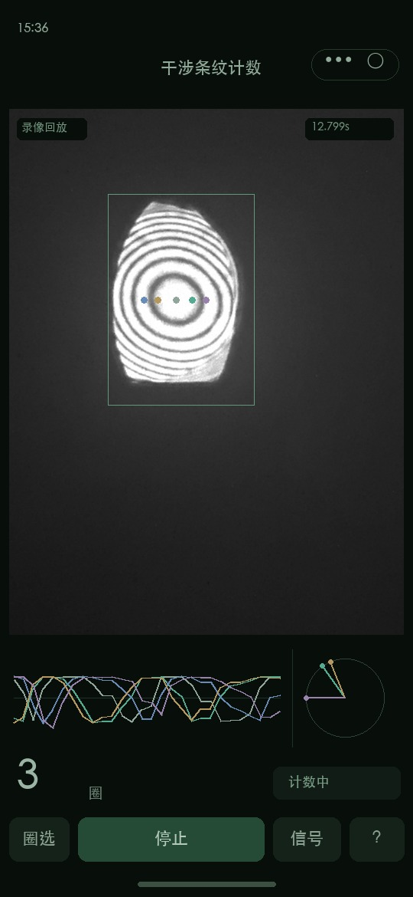

真实手机日志已确认标定760ms成功，但旧看门狗使用处理帧的过期时间误报断流。修订和边界见`handset-calibration-timeout.json`及`stream-diagnostics.json`；修订后手机结果仍待复测。

用户随后反馈手机圈选恢复正常；已移除两次点按方式，仅保留按住拖动，坐标有效性和固定原生节点的修订保留。恢复原因未由原始真机触摸日志单独确认。

真机反馈修订：接收时钟不可用时使用带倒退检测的系统接收时间；明确圈选覆盖层像素尺寸，支持拖动及点两个对角。兼容性检查见`phone-compat.json`。尚未取得修订后手机上的触摸/时钟复测证据，不能宣称真机问题已经确认解决。

本次操作流程更新：标定成功后待开始，手动锁定起点；停止后最多4个有效观测确认已提交数据，再固定结果；完整标定可复用。新增证据见 `measurement-flow.json`、`measurement-legacy-regression.json`、`measurement-ide.json`。微信实际运行时423步对照全部64个状态字段通过；暂存JSON已移除。此前视频及各带哈希的报告保留为上一版界面/构建记录，不能据旧视频认为新版仍会自动开始。

起点区别：从原片279帧任意相位开始，连续变化约83.8617周期，完整净周期显示83；此前84是暗心物理边界跨越净次数。这是测量零点变化，并非新增漏计；实际实验可在同一相位状态记录起止读数。停止后的后续帧不累计。真实帧正放再倒放的程序回归净值为0，该检查不能替代独立反转实验的准确度验收。

# 微信计数核心接入与界面回放

2026-10-14，开发分支`app/wechat-bootstrap`。当前唯一C++相位模型在`research/phase_core.h`；Native文件回放、流式接口和WASM共享。没有维护另一份Python/JavaScript计数算法。轮廓跟踪实现保持原样，原算法的标定和事件规则未针对部署调参。

## 验证结果

| 固定录像测量段 | 帧数 | 净计数 | 输出事件 | Native、Node WASM、WXWebAssembly |
|---|---:|---:|---:|---|
| 自录，9.6–11.6秒标定 | 1158 | 84 | 90 | 全部对应逐帧字段一致 |
| B站，0–8.5秒标定 | 381 | 6 | 6 | 全部对应逐帧字段一致 |

自录90事件含88个确定事件和用户接受的34秒可选减一/加一；不能将90全部称为独立确定真值。B站6事件仍相对临时视觉参考，未独立人工确认。两段均已成为开发数据。

`parity.json`记录完整Native/Node字段与状态对照。整数、方向、事件时间、确认时间、完整性等字段完全一致；最大的浮点差约5×10^-14，连续周期差小于10^-4目标。流式Native与冻结录像输出所有对应字段完全相同，最大确认延迟4帧。`ide-parity.json`记录真正WXWebAssembly执行的两段完整回放，逐输出行检查22字段，最大差同样小于5×10^-14。开发验证比较器读取Native期望结果，正式计数器不读取参考或答案。

真实输入上的不规则/重复时间戳、丢帧间隔、跟踪失败和截断待定事件拒绝检查已通过；平坦标定拒绝、预览坐标映射、面积积分、零填充、尺寸变化与最多一个待处理帧也通过。这些是接口与失效行为验证，不是另一次合成数据准确度成绩。

`live-camera-smoke.json`记录当前Iriun普通场景经相机→预处理→WASM提交256标定帧后的明确失败；显示“—”，没有声称普通画面存在干涉计数。未保存相机画面。`camera-size-probe.json`记录显示尺寸与回调尺寸的两次实测。

## 视频

[竖屏小程序布局回放](miniprogram-original-replay.mp4)，52.25秒，540×1170、24fps。输入显示使用自录原片的红通道预览，从固定标定段开始，展示所有测量段并在片尾停留2秒，最后84圈。

**这是按当前小程序布局渲染的模拟视频，不是手机实拍或开发者工具屏幕录像。** 计数、实际采样位置、五路亮度和共同暗心零点相位均来自生产RGBA适配与流式WASM回放；画面明确标注“录像回放”。图只绘制已收到的观测，显示计数使用当时可用的确认结果，没有提前显示未来事件。它展示界面与固定输入效果，不能代替手机实时采集、预处理裁剪和曝光的验收。视频元数据与来源指纹见`video-manifest.json`。



## 复现

先按根目录说明准备真实原片、派生缓存、固定96像素输入和已激活的Emscripten6.0.12，再执行：

```sh
.venv/bin/python tools/check_live_core.py
.venv/bin/python research/render_miniprogram_video.py
```

完整逐帧结果生成到忽略的`experiments/runs/wechat-core/`；本目录保存事件、汇总、录像及检查证据。界面从`miniprogram/`导入开发工具。开发工具临时完整回放入口见 [接口说明](../../../docs/LIVE_CORE.md)，其JSON输入块不进入Git或发布包。

## 尚待手机现场核验

手机微信里的相机帧方向、预览裁剪和触摸圈选、WASM异常支持、实际有效观测帧率、曝光变化、相位采样速度上限及发热尚未验收。当前Iriun把手机相机送到电脑，运算仍在电脑，不能冒充手机WASM性能。此次没有上传或发布小程序，也没有重新宣称陌生场景的算法鲁棒性。

## RGBA端到端补充核验

`camera-adapter-parity.json`核对缓存的真实红通道帧嵌入RGBA后，经实际页面映射、面积积分和WASM输出的完整链路。两段全部整数、方向、事件/确认时刻、完整状态和有效通道数与Native一致。自录96像素小图逐像素完全一致；B站相对旧OpenCV面积缩放的像素差最大1.79×10^-7，输出浮点差最大1.12×10^-6，整数事件未改变。

源图余量范围的起点对齐到整数像素，其小数余量通过计数偏移传递，保持用户选择的实际区域不变；这避免了半个源图像素的无意平移。标记位置按面积采样单元的中心映射，包含半个输出像素的偏移。没有改动相位参数或逐事件时间。复现：

```sh
.venv/bin/python tools/prepare_camera_replay.py
node tests/replay_camera.cjs original experiments/runs/wechat-core/original-red.raw experiments/runs/wechat-core/original-camera.json experiments/results/real-track/padded-screen.frc experiments/runs/wechat-core/original-camera.csv
node tests/replay_camera.cjs bilibili experiments/runs/wechat-core/bilibili-red.raw experiments/runs/wechat-core/bilibili-camera.json experiments/runs/wechat-core/bilibili.frc experiments/runs/wechat-core/bilibili-camera.csv
.venv/bin/python research/render_miniprogram_video.py
```

保留的是上一段元数据与最近一次不完整段记录；后续成功段不会将该丢失事实覆盖。状态按钮可查看。页面上的计数始终只代表当前测量段。
